# Kestrel

**The operating system for India's streets.**

Every citizen becomes a sensor, every phone a road scanner. Kestrel turns scattered complaints about potholes, garbage dumps, dark streetlights, open manholes and waterlogged roads into **one verified, ranked, publicly tracked issue per problem**, and it keeps riders away from those hazards while the city fixes them.

> Kestrels hover over roadsides and watch everything below. That is the idea: eyes on every street, and nothing reported goes unseen.

**Hackathon:** Build for Bharat

**Track:** Smarter Cities and Civic Infrastructure (Track 5)

**Problem prompt:** Real-Time Civic Issue Reporting and Resolution Tracking

**Live demo:** Coming soon

**Demo video:** [Watch the demo](https://drive.google.com/drive/folders/1wCwrzuFgD5UlVTBjRdDwEf432Hkj_b9U)

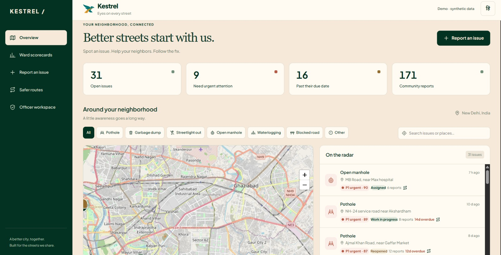

*The civic dashboard brings local issues, community reports, and public progress into one view. Shown with synthetic demo data.*

---

**Status legend used in this README:** ✅ working and tested in this repo · 🧭 planned after the hackathon

---

## 1. The problem

A pothole on a Delhi road is usually not a secret. Dozens of people ride over it every hour. Some of them complain. The complaint goes into a portal, a helpline or a social media post, and from there it disappears.

What breaks is not reporting. It is everything after reporting:

- **Complaints do not add up.** Twenty people report the same pothole and the system sees twenty unrelated tickets, or twenty tickets that each get closed on their own. Nobody can tell that this one hole is the worst on the street.
- **Severity is invisible.** An open manhole next to a school and a faded road marking sit in the same queue. Officers triage by whoever shouts loudest.
- **Response is opaque.** Citizens get a ticket number and silence. "Closed" often means the ticket was closed, not that the road was fixed.
- **Ownership is fragmented.** One street can involve the municipal corporation, the public works department, the water utility, the power distribution company and the traffic police. Citizens do not know who owns which problem, and complaints land at the wrong desk.
- **The danger is live, the fix is slow.** Even a well-run repair takes days. Meanwhile riders keep hitting the same hazard, day after day, because their navigation app knows traffic but nothing about the road surface.

## 2. Who we build for

**Daily commuters and two-wheeler riders** hit the same potholes, open manholes and blocked roads every week, and most have stopped complaining because nothing happens. Kestrel lets them report in about ten seconds by voice in Hindi, English or Hinglish, shows them that other people reported the same problem, and routes them around it while it stays open.

**Residents and RWA volunteers** today chase problems by phone, in WhatsApp groups and through repeated complaints. Kestrel gives them one public page per issue, with a timeline they can share, and a vote that actually changes the issue's priority.

**Ward officers and junior engineers** receive a flood of duplicate, vague and unlocated complaints with no sense of priority. Kestrel gives them one deduplicated queue per ward, ranked by severity, where every issue carries photos, an exact location, a report count and a deadline.

**Civic body leadership** currently measures how many tickets were closed, not whether roads got better. Kestrel gives them ward scorecards built from citizen-confirmed fixes, time to fix and reopen rates.

## 3. Why existing solutions fall short

Government grievance portals, municipal helpline apps and social media complaints all exist. They share the same gaps:

- **Duplicates.** Today every complaint becomes its own ticket. In Kestrel, nearby reports of the same category fuse into one issue that carries a report count.
- **No severity signal.** Today complaints are handled first come, first served. Kestrel computes a transparent severity score from the category, community confirmations, photos, exposure and age.
- **Self-certified closure.** Today the department closes its own ticket. In Kestrel an officer can only mark a fix "resolved"; it becomes "closed" when citizens confirm it, and "still there" votes reopen it.
- **Opaque progress.** Today a citizen gets a ticket number. Kestrel gives every issue a public page showing each state change, who owns it and how long it has been open.
- **Wrong desk.** Today the citizen has to guess the department. In Kestrel the category and the road suggest the responsible agency.
- **No benefit for the reporter.** Today reporting is pure civic duty. In Kestrel reporting also protects you, because open hazards are avoided by Kestrel's routing.
- **Built for English-literate desktop users.** Today's portals are long forms. Kestrel takes voice in Hindi, English and Hinglish, works offline, and is built for 360 px screens and weak networks.

## 4. What Kestrel does

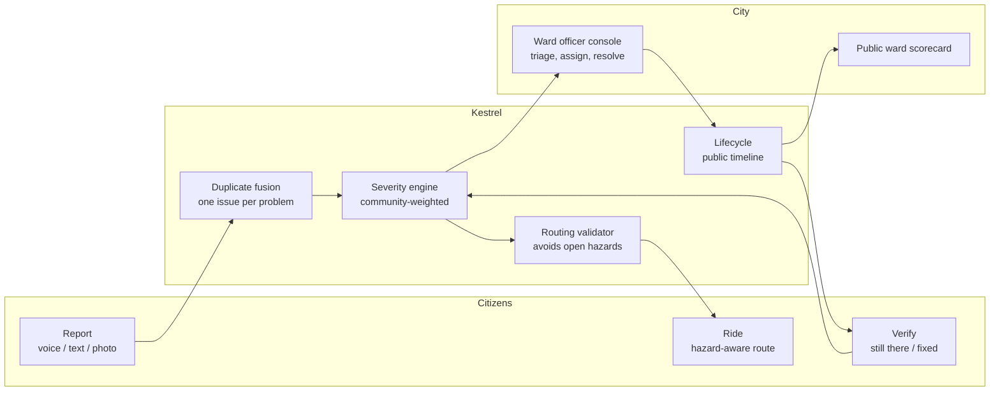

Four promises:

1. **One problem, one issue.** Duplicates strengthen an issue instead of burying it.
2. **Severity you can audit.** Every priority shows the rule and the evidence behind it. No black-box score.
3. **Fixed means citizens agree it is fixed.** Officer resolution is one step. Citizen confirmation closes it.
4. **Claims, not measurements.** Reports are what people say they saw. Kestrel shows evidence, its age and its sources, and says what it does not know.

## 5. The 60-second story

> Priya rides a scooter from Lajpat Nagar to her office every morning. There is a deep pothole near the flyover ramp that she has hit three times this month.

1. **Report (10 s).** Priya taps the mic and says *"flyover ke neeche bada gaddha hai, bahut gehra"*. Kestrel drafts a pothole report at her GPS location and shows *"We understood: pothole, deep, here"*. She attaches a photo and sends it. No signal under the flyover, so it waits in the offline outbox and sends itself a minute later.
2. **Fusion.** Kestrel finds an open pothole issue 12 m away with 6 earlier reports. Priya's report joins it. The issue now shows **7 reports from 7 different people** and rises from P2 to **P1**.
3. **Routing.** Rahul plans the same trip that evening. The route through the ramp is marked **avoided: P1 pothole, 7 reports, 2 photos**, and he gets an alternative that costs +2 min.
4. **Triage.** The ward officer opens the console. The pothole sits at the top of the ward queue with photos, a map pin and an SLA clock. The officer assigns it to the road maintenance team.
5. **Fix.** Two days later the crew marks it **Resolved** with an after-photo.
6. **Confirmation.** Kestrel asks people who reported it: *"Is it fixed?"* Two of them say yes. The issue becomes **Closed: citizen-confirmed**. The ward scorecard counts it as a real fix.

If instead people say *"still there"*, the issue reopens and the reopen counts against the ward's score.

## 6. How it works

### End-to-end flow

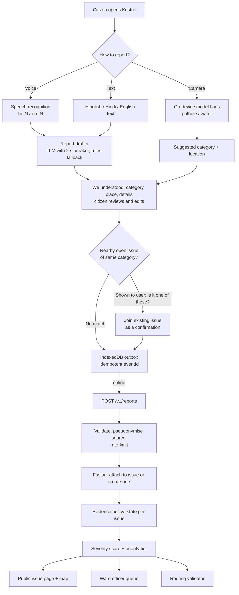

### The two axes of an issue

Every issue has **two independent states**. Mixing them is how most complaint systems lie.

The **evidence state** is moved by citizens' reports and votes under the evidence policy, and it answers the question *"Is the problem there right now, and how sure are we?"*

The **workflow state** is moved by ward officers, and by citizens confirming fixes, and it answers the question *"What is the city doing about it?"*

An officer can mark an issue resolved, but if fresh reports say it is still there, the evidence state shows that and the issue reopens.

## 7. Issue categories

The evidence policy generalises from a single water hazard to a **category-aware policy, `civic-policy-v1`**. Each category has its own fusion radius, freshness window, severity base and routing impact. All values are configuration, tuned for a pilot, not engineering standards.

- **Potholes (`POTHOLE`)** cover potholes, cave-ins and broken road edges. Reports within 25 m fuse into one issue, and a report stays fresh for 30 days. The severity base is 25, plus 10 when the pothole is reported deep. A pothole changes routes once it reaches P1. The likely owner is the road-owning agency, either the municipal corporation or the public works department.
- **Waterlogging (`WATERLOGGING`)** covers flooded underpasses and water on the road. Reports within 60 m fuse, and evidence stays fresh for only 30 minutes. The severity base is 35, and routes avoid it while it is reported. The likely owner is drainage, the public works department or the water utility.
- **Open manholes (`OPEN_MANHOLE`)** cover missing or broken covers. Reports within 15 m fuse and stay fresh for 7 days. The severity base is 40, the highest of any category, and routes always avoid it. The likely owner is the water and sewerage utility.
- **Blocked roads (`BLOCKED_ROAD`)** cover fallen trees, debris and construction without a diversion. Reports within 40 m fuse and stay fresh for 2 hours. The severity base is 30 and routes avoid it. The likely owner is the municipal corporation or the traffic police.
- **Garbage dumps (`GARBAGE_DUMP`)** cover overflowing bins and illegal dumping. Reports within 40 m fuse and stay fresh for 7 days. The severity base is 15, and garbage does not change routes. The likely owner is municipal sanitation.
- **Streetlights out (`STREETLIGHT_OUT`)** cover dark stretches and damaged poles. Reports within 20 m fuse and stay fresh for 7 days. The severity base is 20, and it produces only a night-time advisory on routes. The likely owner is the road-owning agency or the power distribution company.
- **Other (`OTHER`)** covers anything else on the street. Reports within 25 m fuse and stay fresh for 7 days, with a severity base of 10 and no routing effect. It goes to the ward office for triage.

Real ownership always depends on which agency owns the road.

Short-lived hazards (water, blocked roads) expire quickly so routes recover. Slow hazards (potholes, garbage) stay open until someone reports them fixed, because **absence of new reports is not evidence that something was fixed**. That is the same rule the original water policy used: stale evidence is never silently turned green.

## 8. Duplicate fusion

Duplicate grouping is the heart of the prompt. Kestrel prevents duplicates at the source and merges the rest on the server.

**At the source.** Before a report is sent, the app shows open issues of the same category within the fusion radius: *"Is it one of these?"* One tap turns a new complaint into a confirmation of an existing issue.

**On the server.**

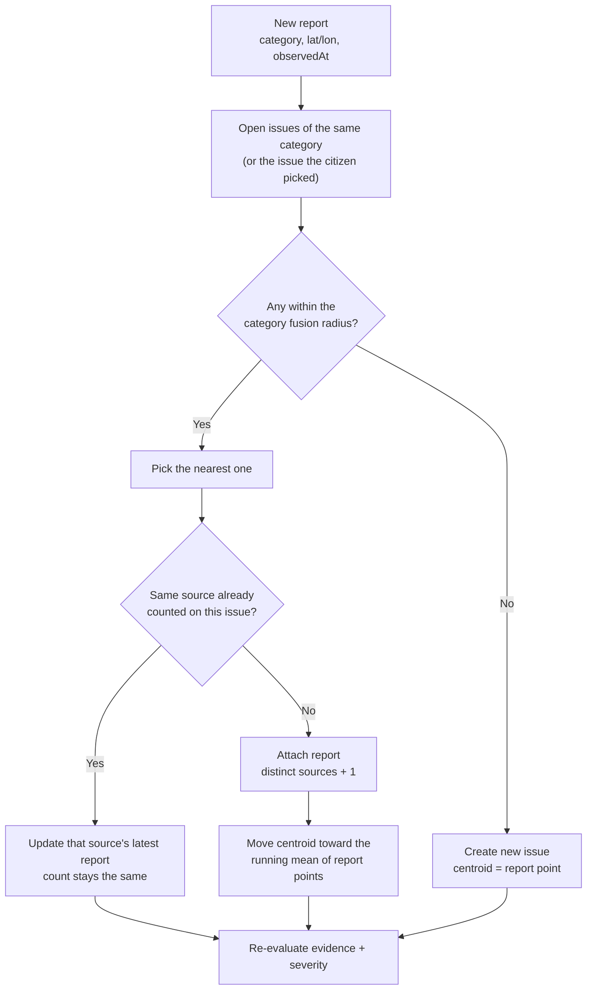

Rules that keep fusion honest:

- **Same category only.** A garbage dump next to a pothole is two issues.
- **Each source counts once per issue.** Sources are HMAC pseudonyms that rotate daily. Ten reports from one phone are one voice.
- **Retries are never witnesses.** The same `eventId` with the same body returns the original result. The same `eventId` with a different body is rejected with `409`.
- **Freshness comes from `observedAt`**, never from upload time, so an offline report that syncs an hour later is treated as an hour old.
- **Writes are revision-guarded.** Two reports arriving at the same moment never overwrite each other.
- **Officers merge what fusion missed.** Two issues reported just outside the radius can be merged by the ward officer; the duplicate is marked `MERGED` with a link, and both timelines record it. Splitting a wrong merge is 🧭.

The clustering approach (running-mean centroid, per-type radius) comes from Kestrel's earlier pothole map and is already covered by tests. The idempotency, pseudonymous sources and revision guards come from the evidence engine and are already covered by tests.

## 9. Community verification and severity

### Evidence states

Each issue has exactly one evidence state at any moment. This is the original evidence state machine, now applied per issue and per category.

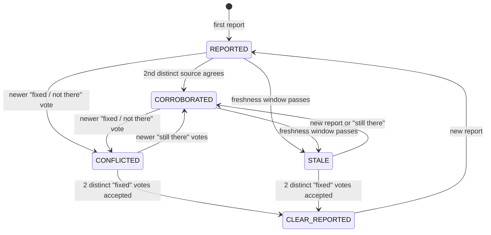

An issue is **`REPORTED`** when one source has reported it, and the public sees "Reported by 1 person". It becomes **`CORROBORATED`** when two or more distinct sources agree, shown as "Confirmed by N people". It is **`CONFLICTED`** when newer votes disagree, shown as "People disagree, needs a check". It is **`STALE`** when nothing fresh has arrived but nobody has reported it fixed either, shown as "Not re-checked recently, still treated as open". Finally it is **`CLEAR_REPORTED`** when two distinct sources say the problem is gone, shown as "Reported fixed by citizens".

### Votes

On any issue, anyone near it can tap one of three buttons:

- **Still there**: a fresh positive observation.
- **Fixed / not there**: a fresh negative observation.
- **Add photo**: evidence attached to the issue, reviewed before it is shown publicly.

Votes go through the same pipeline as reports: same pseudonymous source rules, same idempotency, same rate limits.

### Severity score

Severity is a **transparent sum of named parts**, capped at 100, and the issue page shows the breakdown.

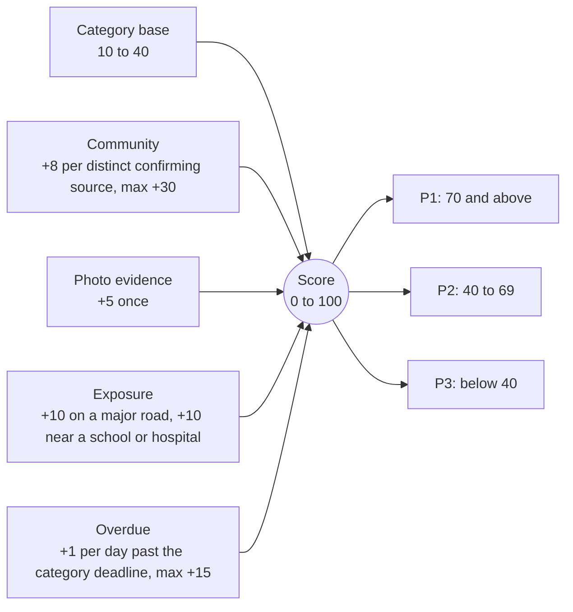

Example: a deep pothole (25 + 10) on a major road (+10) with 5 distinct confirming sources (+30, capped) and a photo (+5) scores **80, P1**, and the page says exactly that.

Conflicting "fixed" votes do not lower the score. They change the evidence state to `CONFLICTED`, which flags the issue for a check.

## 10. Public resolution tracking

### Workflow lifecycle

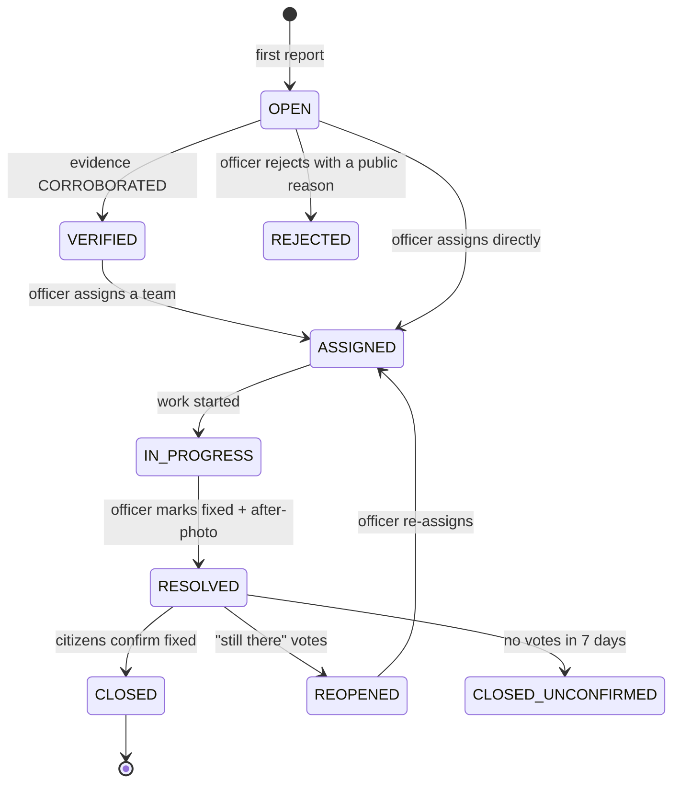

- **`RESOLVED` is not the end.** It starts a confirmation window. People who reported the issue are asked *"Is it fixed?"*.
- **`CLOSED`** needs two distinct "fixed" votes, the same rule that clears evidence.
- **`CLOSED_UNCONFIRMED`** is shown as exactly that. Silence is never presented as confirmation.
- **`REOPENED`** is public and counts against the ward's reopen rate.
- **`REJECTED`** needs a written public reason (duplicate, not civic, private property, wrong location).

### Public issue page

Every issue has a shareable page at `/i/<issueId>` that works without an account and loads fast on 2G/3G:

- Category, location on a map, ward and likely owning agency
- Evidence state, report count, distinct sources and photos
- Severity score with its breakdown
- Workflow state, the deadline for the category and time open
- **A full timeline**: every report (as "Source 3"), vote, assignment, status change and officer note, with timestamps
- Buttons for **Still there**, **Fixed** and **Share** (WhatsApp and Web Share)

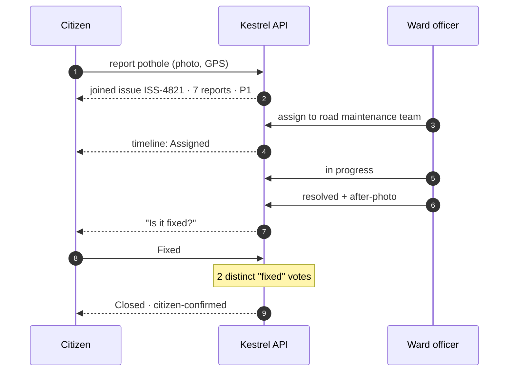

### Ward scorecard

A public page per ward, computed only from data Kestrel can defend:

- **Open issues by priority** counts the P1, P2 and P3 issues that are not closed.
- **Median time to resolve** measures the time from the first report to `RESOLVED`, per category.
- **Citizen-confirmed fix rate** is `CLOSED` divided by the sum of `CLOSED`, `CLOSED_UNCONFIRMED` and `REOPENED`.
- **Reopen rate** counts issues that were reopened after being marked `RESOLVED`.
- **Overdue** counts open issues that are past their category's deadline.

## 11. Ward officer console

A desktop-first view of the same data, for the people who fix things.

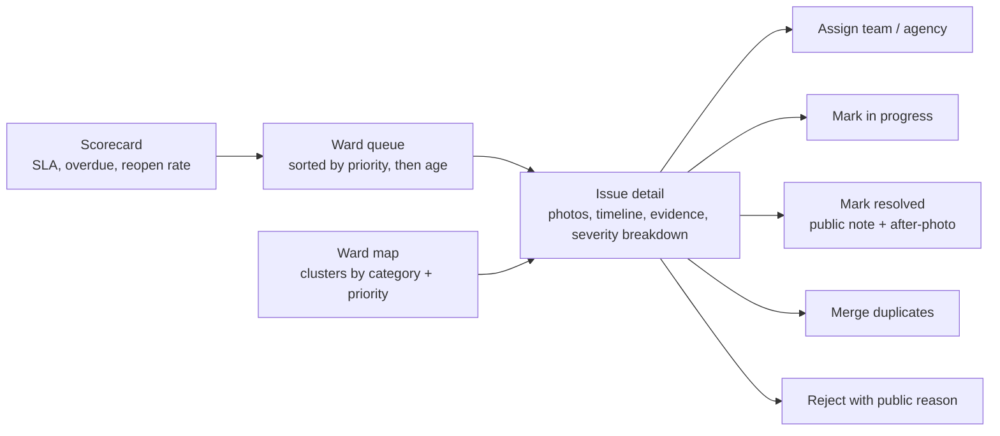

- **Ward-scoped access.** An officer acts only on issues in their ward.
- **Every action is public.** Officer actions appear on the issue timeline with the role, not a personal name.
- **No silent edits.** Officers cannot delete reports or change the evidence state. They can only move the workflow and attach notes.
- **Stale-view protection.** Every action carries the revision the officer looked at; if new reports arrived meanwhile, the action is refused with `STALE_REVISION` so nobody acts on old information.
- **Bulk triage** (assign several P3 issues on one street at once) is 🧭.

## 12. Hazard-aware routing

Routing is Kestrel's answer to *"why should I report?"*: reports protect the reporter and everyone behind them.

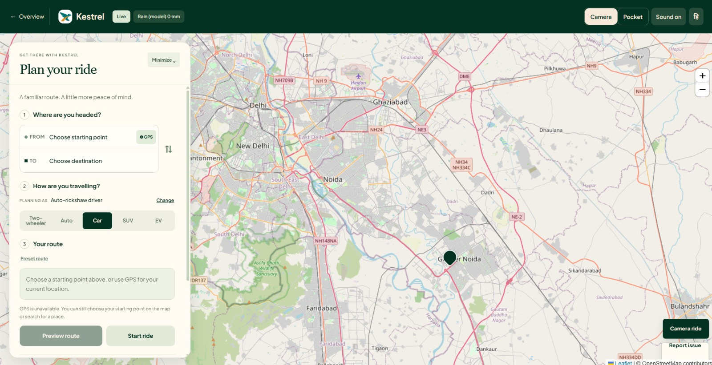

*Plan a trip in three steps: choose your start and destination, select your vehicle, then review the route. Reported road hazards inform route decisions; the map is not a safety guarantee.*

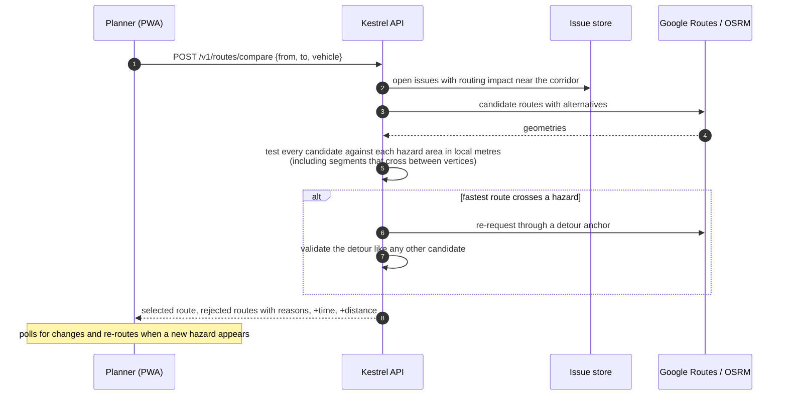

- **Validated avoidance.** A waypoint alone never proves a route avoids a hazard. Every candidate geometry is tested against every hazard area. ✅
- **Every category that blocks a road.** Open manholes, waterlogging, blocked roads and P1 potholes become hazard areas the validator tests every route against. When the fastest route crosses one, Kestrel requests side-step detours either side of it and validates those too. ✅
- **Explained.** The route decision lists each avoided issue with its category, priority and report count (`avoidedIssues`). ✅
- **Never fakes safety.** If no admissible route exists, Kestrel says so instead of drawing a reassuring line. ✅
- **Vehicle-aware wording, never vehicle-aware safety.** A car is told the same as a scooter: reported water is avoided for everyone. ✅
- **Live voice guidance.** Ride mode gives turn-by-turn guidance from GPS, a 3D heading-up map, pocket mode and spoken warnings in en-IN and hi-IN. ✅

## 13. Edge AI road vision

Three models run **in the browser with ONNX Runtime Web**: two watch the road in ride mode, and Kestrel Vision reads citizens' photos. No photo or video leaves the phone for any of them.

The first model is **YOLOv8n** (`app/public/models/pothole-yolov8n.onnx`). It detects potholes, tracks them across frames, and adds a heuristic depth estimate from flat-road geometry, which the app labels "est.". ✅

The second is **SegFormer-b0** trained on ADE20K (`app/public/models/water-segformer-b0-ade.onnx`). It measures what share of the road ahead looks like water. When two of three runs see 15% or more, the app raises "possible water". ✅

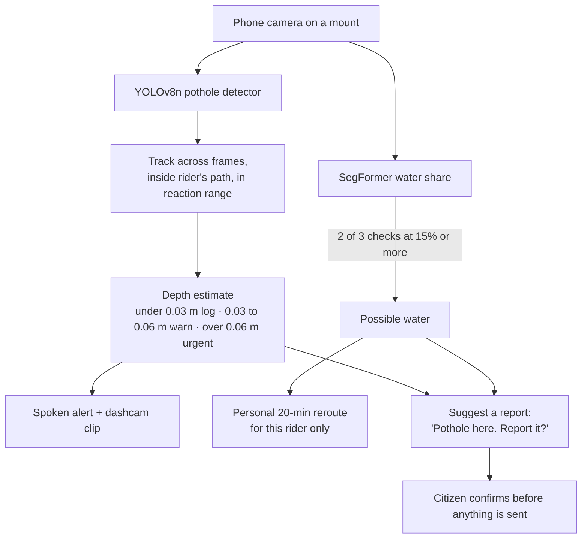

The camera **suggests**, the citizen **decides**. A camera detection is never stored as evidence by itself, because neither model has been validated on Indian road footage. Detections turn into one-tap report suggestions that a person confirms.

### Kestrel Vision: one small model that answers many questions

Kestrel Vision is a 13.7 MB on-device model that looks at a citizen's photo and answers several questions at once. It runs in the browser the moment a photo is added, and every answer is a suggestion the person can override.

**What it does in the app today:**

- **Suggests the category.** It recognises potholes, waterlogging, blocked roads and garbage, and it also knows three "nothing to report" cases: a closed manhole cover, an ordinary road, and a photo that is not of a street at all. When it is confident it fills in the category, otherwise it only shows its guesses. If the citizen already picked a different category, it offers a one-tap switch instead of overriding them.
- **Rejects junk.** Selfies, food, pets and indoor shots get a gentle "this doesn't look like a street photo".
- **Guards against false alarms.** A closed manhole cover prompts "report it only if it is open, broken or sunken".
- **Hints at size.** For potholes it suggests the "deep" detail when the pothole looks large.
- **Protects privacy.** When a face fills the frame it suggests retaking the photo.
- **Matches duplicate photos.** On a public issue page, the viewer's own browser checks whether the citizens' photos show the same spot.
- **Checks the officer's after-photo.** When an issue is marked resolved, every viewer's browser checks whether the after-photo still shows a problem. An officer cannot fake this, because it runs on the citizen's device, not the server. The ward officer sees the same check before submitting.

**How it was built.**

- **The first model memorised datasets.** It was fine-tuned on public datasets and scored 99% on a random split, but only 55.7% on photos from sources it had never seen: it had learned what each dataset looked like, not what a pothole looks like.
- **Teachers.** Kestrel Vision instead starts from two MIT-licensed vision-language models, CLIP RN50 (OpenAI) and CLIP ViT-B/16 (DataComp). They have seen hundreds of millions of varied photos and understand text descriptions.
- **Distillation.** Their knowledge was transferred into a small MobileNetV3-Large student (BSD-licensed weights). The student learned to reproduce both teachers' embeddings on 16,422 unlabelled photos: every Indian road photo in RDD2022, the non-test images of our labelled sets, and a third of the web photos.
- **No text model on the phone.** Each question is answered by comparing the photo's embedding with text descriptions that were embedded once, offline (`app/public/models/kestrel-vision-heads.json`, 198 KB). A new category is a new set of descriptions, not a new training run.
- **The licence was checked.** Apple's MobileCLIP was tested and scored well, but its research-only licence rules it out for a public app.

**How it was tested.**

- **Hand-verified photos.** Keyword search on Wikimedia Commons and Openverse returned photos whose labels were right anywhere from 0% to 95% of the time, depending on the class. Every open-manhole result, for example, was a screenshot from the virtual world Second Life. So every test photo was checked by eye, which left 433 verified web photos.
- **Held-out sources.** These were combined with the held-out sources from the earlier work.
- **Separate dev and test halves.** The descriptions, a small per-class bias and the confidence threshold were chosen on the dev half only. The test half was used once, at the end.
- **Reproducible.** All numbers are in `ml/vision_eval_test.json`.

**Results on the test half (431 photos it never saw):**

- **Overall.** The phone model is right 84.5% of the time across all seven classes: 89.5% on web photos and 79.6% on the held-out sources. The two big teacher models, too large for a phone, reach 86.3%.
- **Per class:** potholes 23 of 24, waterlogging 25 of 30, blocked roads 10 of 11, garbage 121 of 153, closed manhole covers 81 of 89, ordinary roads 60 of 74, and not-a-street photos 44 of 50.
- **When it pre-fills.** The app fills in the category only above a confidence of 0.8, chosen on dev. On the test half that happened for 70.5% of photos, and it was right 94.4% of the time.
- **After-photo check.** Deciding whether a site still shows a problem was right 93.4% of the time (95.9% of problems caught, 90.2% of genuine fixes recognised).
- **Duplicate photos.** At the similarity threshold chosen on dev, it recognised 93.3% of same-spot photo pairs while matching only 5.2% of different spots (`sameSpot` in the results file).
- **Pothole size.** The size hint ranks severe potholes above minor ones with an AUC of 0.70 on a labelled pothole set. That is a real but modest signal, which is why it only suggests the "deep" chip and never applies it.

**Known limits.**

- **Open manholes are not yet measured.** No genuine open-manhole photos could be found, so that class exists but is effectively never suggested until real photos are collected.
- **Weaker on unusual framings.** The phone model is weaker on extreme close-up texture crops and on photos where litter is a small part of the scene.

**The path to better accuracy is Kestrel itself.** Every report whose category is confirmed by other citizens is a verified Indian street photo, and `ml/` already contains the whole pipeline to fold them in and re-measure:
- the downloaders (`fetch_*.py`);
- distillation (`distill_student.py`);
- prompt tuning on dev only (`tune_prompts.py`);
- the honest evaluation (`evaluate_vision.py`);
- packaging for the app (`build_vision_heads.py`).

## 14. Built for Bharat

- **Language.** The interface is in English and Hindi, and reports can be spoken or typed in Hindi, English or Hinglish (*"gaddha"*, *"paani bhara hai"*, *"light nahi jal rahi"*). ✅
- **Voice.** Input uses the browser's speech recognition. Alerts use neural en-IN and hi-IN voices, with the phone's built-in voice as an instant fallback. ✅
- **Weak networks.** A durable IndexedDB outbox keeps reports through reloads and offline periods, retries them with the same `eventId`, and sends them one at a time so nothing is duplicated. A service worker caches the app shell. ✅
- **Low-end phones.** There is no front-end framework, just plain TypeScript and Vite. Camera models load only when ride mode starts, and everything works at 360 px width. ✅
- **First-time users.** Citizens say it or tap one of seven big category tiles, GPS fills in the place, and they send. Touch targets are large, and every state is shown with an icon, text and colour together. ✅
- **Accessibility.** Status is never shown by colour alone, alerts are spoken, and riders get a pocket mode with a black screen. ✅
- **Sharing.** Every issue has a public link (`#/i/<id>`) that can be shared through the Web Share sheet or WhatsApp. ✅

## 15. Architecture

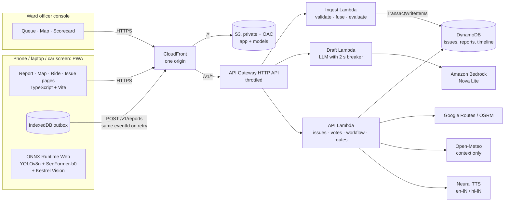

**Design choices**

- **Pure domain core.** `backend/src/domain/` is standard-library Python with no cloud imports: policy, fusion, severity, lifecycle, geometry and validation run the same locally, in tests and on Lambda. ✅
- **One origin.** The CDN serves the app and forwards `/v1/*` to the API. No CORS problems, and HTTPS for camera and GPS.
- **Two stores, one contract.** An in-process store for local runs and tests, DynamoDB in the cloud. Same revision and idempotency behaviour. ✅
- **Scales to zero.** No VPC, NAT gateway or provisioned capacity. Near-zero idle cost, which matters for a civic pilot.
- **Spatial lookup without a GIS server.** For the pilot, a namespace's issues live in one partition and fusion filters them by distance in local metres. That is fine for thousands of issues; geohash-cell partitions are the documented upgrade before city scale (🧭).

### Reporting sequence

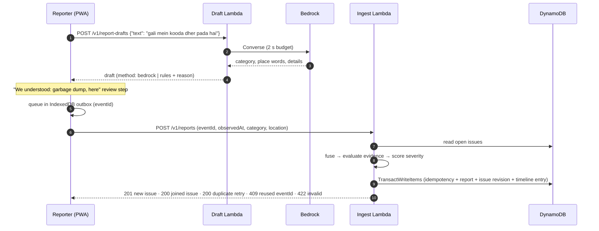

**LLM guardrails** (carried over from the existing drafter, ✅):

- **2 second circuit breaker.** Slow or failing model calls fall back to deterministic keyword rules. The user never sees a `500`.
- **Untrusted input.** The prompt treats the message as data and ignores instructions inside it.
- **No invented facts.** Places and depths must be quoted from the original text.
- **Drafts never change state.** A draft is a suggestion until the citizen reviews and sends it.

## 16. Data model

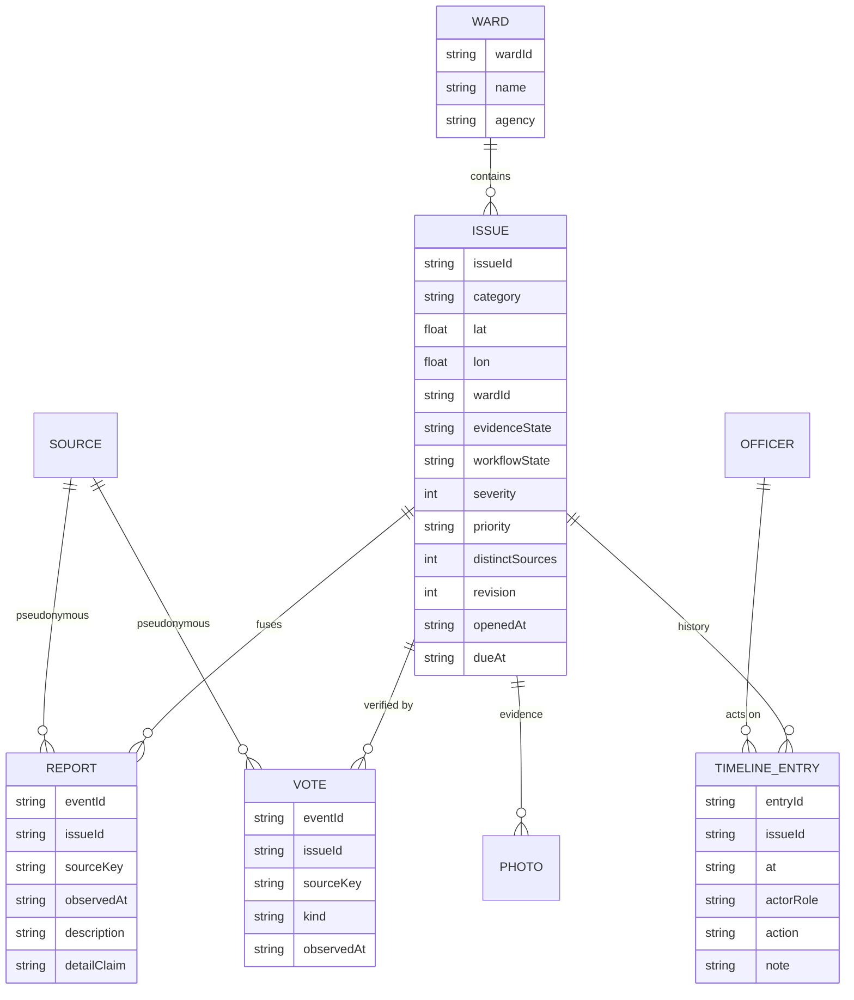

DynamoDB single-table layout (extends the existing key design):

- The partition `NS#<ns>#ISSUES` with sort key `ISSUE#<id>` holds each issue, with its reports, votes and timeline embedded. It is written with a `revision` condition.
- The partition `NS#<ns>#PHOTO#<photoId>` with sort key `PHOTO` holds one compressed photo of at most 300 KB.
- The partition `NS#<ns>#ACTOR#<sourceKey>` with sort key `EVENT#<eventId>` holds the idempotency record and payload hash, with a TTL.

Idempotency record, photo and issue are written in one `TransactWriteItems`. Embedding reports keeps every read to one item; it is capped at the latest 300 observations per issue, and per-report items plus geohash partitions are the upgrade path (🧭).

## 17. API

Errors use one envelope: `{"error": {"code", "message", "retryable", "requestId"}}`.

All of these endpoints are implemented and tested. ✅

**Reading issues (public).**
- `GET /v1/status` returns the mode, policy version, capabilities and server time.
- `GET /v1/issues?status=&category=&ward=&bbox=&near=` lists issues with their evidence, workflow and severity. With `near=lat,lon` it lists same-category candidates for "is it one of these?".
- `GET /v1/issues/{id}` returns the issue page: redacted evidence ("Source 1"), the severity breakdown and the timeline.
- `GET /v1/wards` lists the sample wards with their scorecards, and `GET /v1/wards/{id}/scorecard` returns one ward's metrics.
- `GET /v1/photos/{id}` returns photo bytes. It is public in demo mode only; outside demo mode photos stay private until a review and blur pipeline exists.

**Writing as a citizen (contributor).**
- `POST /v1/reports` takes an idempotent report with an optional photo. It answers `201` for a new issue, `200` when the report joined an issue or was a duplicate retry, and `409` when an event ID is reused with a different body.
- `POST /v1/issues/{id}/votes` records `STILL_THERE` or `FIXED`, idempotently.
- `POST /v1/report-drafts` turns free text into a draft with `suggestedCategory` and `suggestedDetails`. It never changes state.

**Acting as a ward officer.**
- `GET /v1/wards/{id}/queue` returns the ward's open issues sorted by priority.
- `POST /v1/issues/{id}/transitions` applies `ASSIGN`, `START`, `RESOLVE` (with a note and after-photo), `REJECT` (with a public note) or `MERGE`, and is revision-checked.

**Routing and context (public).**
- `POST /v1/routes/compare` returns a route decision that avoids open hazards in every route-blocking category, with reasons and `avoidedIssues`.
- `GET /v1/geocode` searches places, `GET /v1/weather` gives rainfall context (never evidence), and `GET /v1/tts?text=&lang=en|hi` returns a neural voice MP3.

**Demo control.** `POST /v1/demo/control` resets the data, moves the demo clock and simulates failures. It needs the demo admin key and exists only in demo mode.

## 18. Trust, safety and privacy

- **Reports are claims, not measurements.** The UI says "reported by", never "detected" or "verified by the city", unless that is true.
- **Pseudonymous sources.** Contributor identities are HMAC-hashed on the server with a daily rotation. Public pages show "Source 1", "Source 2".
- **No identity from the request body.** Who is calling comes only from the transport (demo header or a JWT), never from a field the browser can set.
- **Strict validation.** Unknown fields are rejected, so a client cannot smuggle in `verified`, `official` or `severity`.
- **Free text stays private** outside demo mode, because it can contain personal details.
- **Photos stay private outside demo mode.** They are resized on the phone, checked server-side (JPEG/WebP magic bytes, ≤ 300 KB), and only served publicly in demo mode until a review and face/number-plate blur pipeline exists (🧭).
- **Rate limits** per source (10 per minute, 100 per day) and API throttling.
- **Coordinated abuse is a known limit.** Several accounts can still push a fake issue up. Mitigations: distinct-source counting, photo weight, officer rejection with a public reason, and sign-in for pilot mode.

## 19. Run it locally

No cloud account needed. Requires **Python 3.12+** and **Node 22+** (Node 24 tested). The backend uses only the Python standard library.

**One command:**

```bash
python run.py
```

It installs what is missing, builds the app if the source changed, starts the server, opens an HTTPS tunnel and **prints a QR code**. Scan it and the app opens on your phone with camera and GPS working. Ctrl+C stops everything.

Options: `--no-tunnel` (LAN only, camera disabled without HTTPS), `--port N`, `--rebuild`.

**Manual:**

```bash
cd app
npm install
npm run build
cd ..
python backend/local_server.py        # http://127.0.0.1:8787  (APP_MODE=local-demo)
```

For UI work with hot reload: `cd app && npm run dev` (Vite proxies `/v1` to the local server).

**The 2-minute demo** (the local server seeds 39 sample issues across 8 Delhi localities on start):

1. Open `http://127.0.0.1:8787`. The **Issues** tab shows every open issue on the map and ranked by severity.
2. Tap **Report**, say or type *"Ring Road pe bahut gehra gaddha hai"*. Kestrel picks **Pothole · Deep · Main road**, GPS fills the place, and "Is it one of these?" lists nearby duplicates. Send it.
3. On a second phone (or **Demo: act as another citizen**), report the same spot. Both reports fuse into one issue, which becomes **Verified** and rises in priority.
4. Open **Officer**, pick the ward, select the issue, **Assign**, then **Mark resolved** with a note.
5. Open the issue page and vote **It's fixed** from two citizens. The issue closes as **citizen-confirmed**, and the ward scorecard counts it. Two **Still there** votes would reopen it instead.
6. **Ride** shows routing: open manholes, waterlogging, blocked roads and P1 potholes are avoided.

Reset to the sample data at any time:

```bash
curl -X POST http://127.0.0.1:8787/v1/demo/control -H "content-type: application/json" -H "x-demo-admin-key: local-demo-admin" -d '{"reset": true}'
```

On Windows PowerShell 5.1, `&&` does not work. Run each command on its own line.

**Drive the demo from a terminal:**

```bash
python scripts/demo.py status
python scripts/demo.py report a          # synthetic contributor A reports
python scripts/demo.py report b          # a second distinct source corroborates
python scripts/demo.py compare           # route decision with reasons
python scripts/demo.py advance 35        # demo clock +35 min
python scripts/demo.py reset
```

Every report this script sends is synthetic and stored with provenance `SYNTHETIC_DEMO`.

## 20. Deploy

The cloud stack is defined in `backend/template.yaml` (AWS SAM): CloudFront, a private S3 bucket with Origin Access Control, an HTTP API with throttling, three Python 3.12 Lambdas on arm64, DynamoDB with transactions and TTL, Bedrock and CloudWatch Logs.

```bash
cd backend
sam build --use-container
sam deploy --guided --stack-name kestrel --region <your-region> \
  --capabilities CAPABILITY_IAM \
  --parameter-overrides DemoAdminKey=<16+ random chars> PseudonymSalt=<16+ random chars> \
    BuildId=$(git rev-parse --short HEAD) \
    BedrockModelId=<optional model or inference profile> \
    GoogleMapsApiKey=<optional Routes API key>

cd ../app
npm run build
aws s3 sync dist s3://<SiteBucketName> --delete
aws cloudfront create-invalidation --distribution-id <DistributionId> --paths "/*"

DEMO_ADMIN_KEY=<same key> python ../scripts/demo.py --api <AppUrl> smoke
```

- Use a Bedrock model enabled in your account and Region, or leave it empty for rules-only drafting.
- The template deploys demo mode only. Pilot mode (real citizen accounts, officer roles) needs a JWT authorizer on write routes first.
- Teardown: empty the site bucket, then `sam delete --stack-name kestrel`.

## 21. Tests

**Backend: `python -m unittest discover -s backend/tests -v`** runs 101 tests, and all 101 pass. ✅
- For the civic layer they cover:
  - fusion radius per category, joining a picked issue, counting the same source once and placing the centre from distinct sources;
  - retries and `409`, strict validation and photos;
  - severity parts and the cap, overdue points, two-vote clearing and stale-not-green;
  - every workflow transition and permission, citizen-confirmed closure, reopen, silence becoming closed-unconfirmed, the deadline clock stopping at resolved, and merge;
  - the pseudonymous timeline, the ward-scoped queue, dedupe candidates, route blocking with side-step anchors, Hinglish category detection and seed coverage.
- For the original layer they cover:
  - evidence-policy scenarios, idempotency and `409` on reused event IDs, revision conflicts and the DynamoDB transaction shape;
  - Hinglish extraction (positive, negated and ambiguous) and the LLM breaker (timeout, hallucinated place, invented depth);
  - route validation with dynamic bypass, depth claims and weather.

**Frontend: `cd app && npm run check`** runs 8 suites, all passing: the camera alert engine, outbox retries and single-flight, the navigation core, the water and depth heuristics, the map tint, the pothole log, and the Kestrel Vision maths (similarity, scoring, class bias, numerical safety). ✅

**Kestrel Vision: `ml/.venv/Scripts/python ml/evaluate_vision.py --split test`** scores the phone model and its teachers on 431 hand-verified photos it never saw. It covers category accuracy, the confidence threshold, duplicate-photo matching and pothole size, and the numbers are in section 13. The packaging step (`ml/build_vision_heads.py`) refuses to ship a model whose fp16 weights change the embedding (cosine below 0.999). ✅

**Earlier clustering service: `python server/test_server.py`** checks pothole clustering (merge within radius, separate by type and distance) and consensus scoring with decay. It passes. ✅

**HTTP smoke test: `python scripts/demo.py --api <url> smoke`** runs the golden journey over HTTP: idempotency, `409`, corroboration, the route switch, concurrent writes, rejection of anonymous writes, stale evidence and provider failure. It passes against a deployed stack. ✅

**Browser end-to-end: `node scripts/e2e-browser.mjs <out-dir>`** drives headless Chrome with a fake camera and GPS at 360 px through report, review, submit, corroboration, the route switch, the evidence drawer, Hindi, the offline queue and ride mode. It passes locally. ✅

**Mutation checks.** Loosening the clear threshold, the fusion radius, the reopen rule or the community cap each makes the civic suite fail, which proves the tests guard those rules. ✅

**Headless Chrome walk-through at 390 px and 1366 px.** This covers the issues map, the issue page, a Hinglish report (category and details detected, GPS, new issue), an officer assigning from the queue, the ward scorecards and the Ride tab, with no console errors. Kestrel Vision was driven the same way: real flood, garbage and selfie photos through the report wizard, plus resolved issues whose after-photo was either a real fix or a still-broken road. ✅

## 22. Configuration

See [.env.example](.env.example). Secrets live only on the server. The browser receives no credentials.

**Server settings:**
- `APP_MODE` picks `local-demo`, `aws-demo` or `live-pilot`.
- `DEMO_ADMIN_KEY` unlocks demo officer and reviewer actions and `/v1/demo/control`.
- `PSEUDONYM_SALT` is the HMAC salt for source pseudonyms, required outside `local-demo`.
- `EVIDENCE_FRESHNESS_MINUTES` sets the freshness window for short-lived hazards (default 30).
- `HAZARD_POLL_SECONDS` is the poll interval the client is told to use (default 15).
- `RETENTION_DAYS` sets the DynamoDB TTL for reports and idempotency rows.
- `GOOGLE_MAPS_API_KEY` optionally enables the Google Routes API; when empty, routing uses public OSRM.

**Cloud-only server settings:**
- `TABLE_NAME` switches storage to DynamoDB when set and to the in-process store when unset.
- `BEDROCK_MODEL_ID` selects the LLM for report drafts; when empty, drafting uses rules only.

**Build-time settings:**
- `VITE_API_BASE` sets the API origin; empty means same origin.
- `VITE_GOOGLE_MAPS_KEY` optionally enables the Maps JavaScript API; when empty, the map uses OpenStreetMap via Leaflet.

## 23. Repository layout

```
app/                       Vite + TypeScript PWA, no framework
  src/flood/               planner, reporter, evidence drawer, API client,
                           offline outbox, navigation core, EN/HI strings
  src/map/                 Google Maps / Leaflet map view, markers, tint
  src/main.ts              screen wiring, ride mode, camera loop
  src/detector.ts          YOLOv8n pothole detector (ONNX Runtime Web)
  src/waterModel.ts        SegFormer water segmentation
  src/hazards.ts           camera alert engine (tracking, path, range)
  src/potholeDepth.ts      depth estimate heuristic
  src/dashcam.ts           speed-adaptive recorder
  public/models/           ONNX models
  public/sw.js             service worker
backend/
  src/domain/              policy, geometry, routes, validation, extraction
                           (pure, standard library)
  src/providers/           LLM drafting, routing / geocode / weather, TTS
  src/storage/             in-process store and DynamoDB adapter
  src/service.py           operations, idempotency, revisions, auth mapping
  src/handlers/api.py      Lambda entry point
  src/data/                corridor fixtures, landmarks, data sources
  template.yaml            AWS SAM stack
  local_server.py          local server, same contract
  tests/                   unittest suites
server/                    earlier pothole clustering service (FastAPI + SQLite),
                           source of the fusion approach
scripts/                   demo driver, browser e2e, corridor fetcher
ml/                        Kestrel Vision: data fetchers, distillation,
                           prompt tuning, evaluation and packaging
android/                   installing the PWA as an Android app (TWA)
run.py                     one-command local run with HTTPS tunnel + QR code
```

Civic layer: `backend/src/domain/{categories,evidence,fusion,severity,lifecycle}.py`, `backend/src/civic.py` (operations), `backend/src/seed.py` (sample data), `backend/src/data/wards.json`; `app/src/civic/` (shell and router, issues map, report wizard, issue page, ward scorecards, officer console); `scripts/make_icons.py` (app icons from the brand logo); `app/src/civic/vision.ts` and `visionMath.ts` (Kestrel Vision on the phone); `ml/` (Kestrel Vision training and evaluation, see section 13).

## 24. Build status and roadmap

### Carried over and working ✅

- Evidence engine: per-source counting, idempotency, freshness from `observedAt`, revision guards, stale-never-green, conflict handling
- Route validation against hazard polygons, dynamic bypass, explained decisions
- Hindi / English / Hinglish drafting with LLM breaker and rules fallback
- Offline IndexedDB outbox, service worker, voice I/O, neural TTS
- Ride mode: GPS guidance, 3D map, pocket mode, dashcam, two on-device models
- Pothole clustering and consensus scoring (earlier service)
- AWS SAM stack, local server, 7 frontend check suites

### Built for the hackathon ✅

- `civic-policy-v1`: seven categories, each with its own fusion radius, freshness, severity base, routing impact and deadline
- Reports anywhere in Delhi NCR, fused into one issue per problem; "is it one of these?" before sending
- Community votes (still there / fixed), auditable severity score, two-axis issues (evidence vs workflow)
- Lifecycle with citizen-confirmed closure, reopen, closed-unconfirmed; public issue pages with timelines
- Ward officer console (assign, start, resolve, reject, merge) and public ward scorecards
- Routing that avoids every route-blocking category, with side-step detours
- 39 realistic sample issues across 8 Delhi localities, built through the real pipeline
- New Kestrel design system and logo; Hindi and English throughout the civic app
- Kestrel Vision (section 13): a 13.7 MB on-device model distilled from two MIT-licensed CLIP models. It suggests the category, rejects junk photos, hints at pothole size, nudges on privacy, matches duplicate photos and checks officers' after-photos, measured on hand-verified photos it never saw

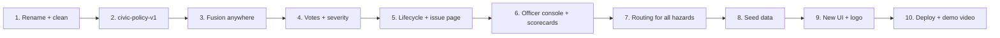

### After the hackathon 🧭

- Sign-in (phone OTP) and a JWT authorizer for real citizen and officer accounts
- Photo review pipeline with face and number-plate blurring
- A multi-class road *detection* model for ride mode trained on Indian data (pothole, waterlogging, stalled vehicle, blockage), with dataset licences checked first
- Splitting a wrong merge, bulk triage, geohash-partitioned storage for city scale
- Export to existing municipal grievance systems so officers do not use two tools
- More regional languages for reporting and voice
- Open data feed of anonymised, aggregated issues for researchers and journalists

### Known limits

- Reports are claims. Distinct-source counting is pseudonymous and approximate.
- Camera estimates are heuristics, not validated on Indian road footage.
- Ward boundaries and agency ownership in the demo are sample data and need confirmation with the civic body before a real pilot.
- The demo runs on synthetic data, labelled as such on every screen.

## 25. Value and adoption

**For citizens:** a report takes seconds, counts, is visible, and protects them on the road the same day.

**For ward officers:** fewer, better tickets. One issue instead of twenty complaints, with photos, an exact location, a priority and a deadline.

**For civic bodies:** a measure of road condition that citizens trust, because a fix only counts when citizens confirm it.

**Adoption path**

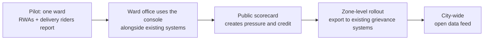

- **Cheap to run.** Serverless, scales to zero, no GIS server, no native app store release needed (installable PWA).
- **Seeding the network.** Delivery riders, auto drivers and RWAs already travel the same roads every day and benefit directly from hazard-aware routing.
- **Fits existing systems.** Kestrel deduplicates and ranks. It can forward one clean issue to an existing grievance system instead of replacing it.

## 26. How Kestrel maps to the judging criteria

**Problem understanding (25%).** Sections [1](#1-the-problem), [2](#2-who-we-build-for) and [3](#3-why-existing-solutions-fall-short) explain why complaints fail today: duplicates, invisible severity, self-certified closure and fragmented ownership.

**Working solution (25%).** Kestrel is a real PWA and API with tested evidence, routing and offline engines ([section 21](#21-tests)), a one-command local run and a serverless deploy.

**Innovation (20%).** Issues have two axes (evidence versus workflow), closure needs citizen confirmation, severity is auditable, reports reroute riders, and edge AI suggests but never decides.

**Value and impact (20%).** Officers get fewer and better tickets, wards get public scorecards, reporters get a direct personal benefit, and there is a clear pilot path ([section 25](#25-value-and-adoption)).

**User experience (10%).** Voice works in Hindi, English and Hinglish, reports survive offline, layouts work at 360 px, no state relies on colour alone, and alerts are spoken ([section 14](#14-built-for-bharat)).

---

Map data © OpenStreetMap contributors (ODbL). Place search via Photon and Nominatim.
